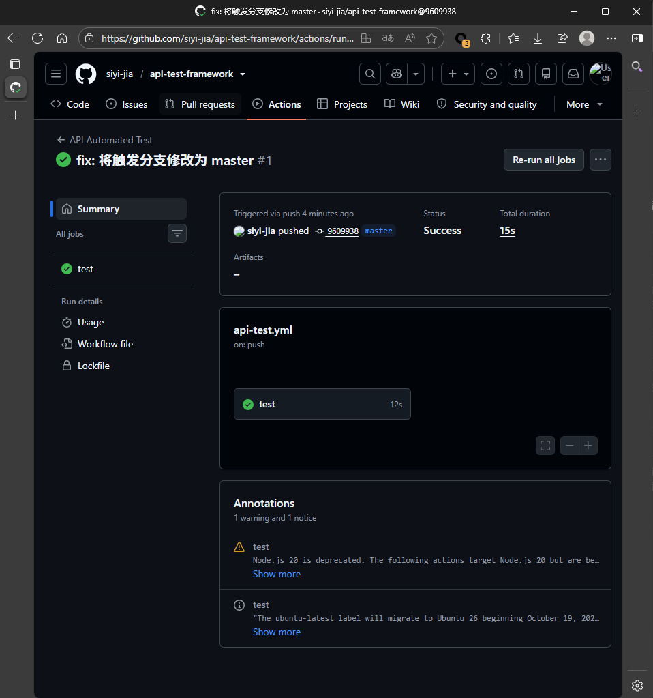

# 基于 Python 的接口自动化测试框架

## 📖 项目简介
本项目基于 Python + Pytest + Requests 搭建，针对 Restful API 进行自动化测试，覆盖增删改查（CRUD）核心业务场景。

## 🛠️ 技术栈
- **语言**：Python 3.10
- **测试框架**：Pytest
- **请求库**：Requests
- **报告**：Allure
- **CI/CD**：GitHub Actions

## 📁 目录结构
```text
├── api/            # 接口封装层（CRUD逻辑）
├── testcases/      # 测试用例层（断言、参数化）
├── utils/          # 工具层（请求统一封装）
├── data/           # 数据驱动（YAML）
├── .github/workflows/ # CI流水线配置
└── README.md


